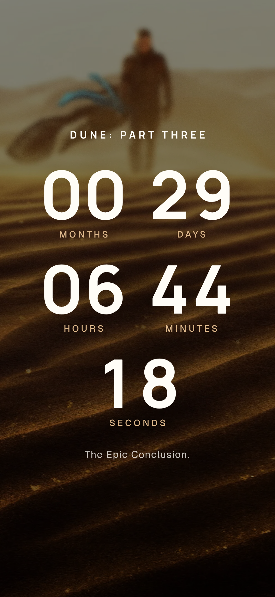
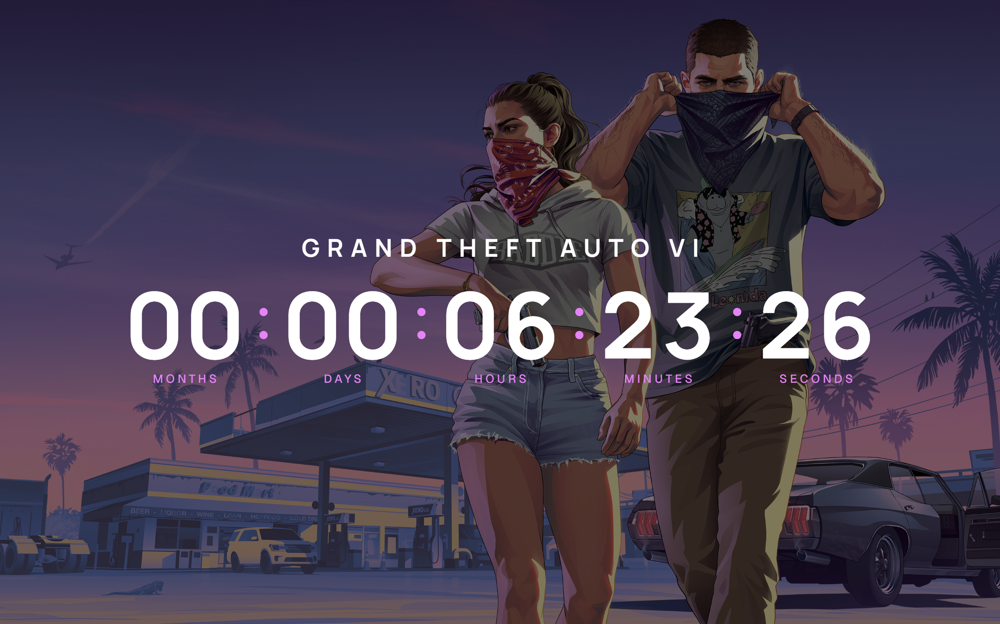

<div align="center">


# Zero Hour

A clean, customizable countdown.

[](./LICENSE)
[](https://github.com/johnarp/zero-hour/releases/latest)

[**Go to Zero Hour**](https://johnarp.github.io/zero-hour/)

</div>

## ✨ Features

- Create multiple countdowns as presets
- Live editing
- Customization including music and backgrounds
- Works at any size
- Everything is saved in your browser. Export or import anytime
- `Esc` to close the editor and `F` to toggle fullscreen

## 🖼️ Preview

| Mobile | Desktop |
| :-: | :-: |
|  |  |

## 🚀 Installation

### 🌐 Website

Open [**johnarp.github.io/zero-hour**](https://johnarp.github.io/zero-hour) in any modern browser, on your phone or desktop. There is no install or account to create.

### 💽 Local

Serve the project over HTTP and open it in a browser.

```
git clone https://github.com/johnarp/zero-hour.git
cd zero-hour
python -m http.server 3000
```

Then, open `http://localhost:3000` in your browser.

## 📂 Files

```
assets/
css/				styling
js/clock.js			clock, stage, and countdown grid
js/data.js			fonts, themes, defaults, validation, date math, saving
js/editor.js		editor sheet, export and import
js/main.js			starts everything and runs 1s tick
js/music.js			music tile
js/sw.js			for 'install as app'
js/ui.js			switching views, auto-hiding controls, fullscreen
index.html
```

## 🖌️ Customizing

- **Add a font:** Add a `<link>` for it in `index.html`, and then add an entry to `FONTS` in `js/data.js`.
- **Add a quick theme:** Add an entry to `THEMES` in `js/data.js`.

## 🤔 Troubleshooting

- **YouTube stays on "Loading" or shows an error:** There should be a pop-up message explaining why. The most common cause is the video owner blocking embedding.
- **Music doesn't start by itself:** This is intentional. Browsers block sound until you interact with the page.
- **Background image won't load from a link:** Some sites block hotlinking. Try another link or upload the file instead.
- **Changes are not saved:** Private windows or some browser settings can disable localStorage. Use Export to keep a copy, or try a different browser, changing those settings, or don't use private windows.

## 📄 License

This project is licensed under the [MIT License](./LICENSE).